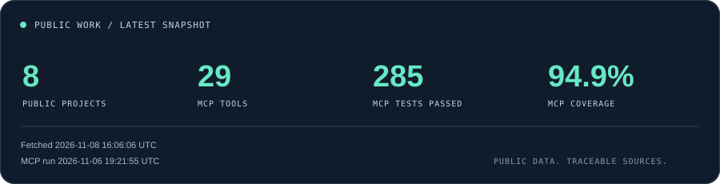

<picture>
  <source media="(max-width: 600px)" srcset="assets/header-mobile.svg">
  
</picture>

# Hi, I'm Vardh.

I work on **AI agents, retrieval, and model evaluation**. I like being able to trace an answer back to its source and check whether a change actually makes a system better.

I'm a **Machine Learning Engineer at MyEdMaster**, where I build adaptive tutoring and student assessment tools. I studied computer science at **George Washington University** and **VIT**.

**[LinkedIn ↗](https://www.linkedin.com/in/vardh-jain-258359200/)** &nbsp;·&nbsp; **[Explore my repositories](https://github.com/vardhjain?tab=repositories)** &nbsp;·&nbsp; **[Published research](https://link.springer.com/chapter/10.1007/978-3-031-78931-1_26)**

## A few things I've built

### 01 / Tools that look things up before they answer

**[finos-mcp](https://github.com/vardhjain/finos-mcp)** · Python / MCP / hybrid search

I built three read-only MCP servers so AI assistants can look up financial-industry standards before answering. They cover AI governance, the Common Domain Model, and FDC3. The packages are on PyPI and work with local copies of the standards, with validation and an audit trail for tool calls. This is an independent community project, unaffiliated with FINOS.

While building the parsers, I found a YAML bug in the upstream framework. My **[fix was merged by FINOS](https://github.com/finos/ai-governance-framework/pull/380)**, restoring **21 risk links** across eight files.

[Read the engineering story](https://vardhjain.github.io/finos-mcp/) · [Try a real tool call](https://github.com/vardhjain/finos-mcp/blob/main/docs/use-cases.md)

### 02 / From a bias flag to a measured fix

**[EthicLens](https://github.com/vardhjain/Ethiclens)** · FastAPI / React / Postgres / MLflow

EthicLens helps people check a model for bias, try fixes, and compare the results on held-out data. I wrote the fairness calculations from scratch and checked them against Fairlearn to a **1e-9 tolerance**. Reviewers can sign off on an audit, with a record of what they approved. It supports that review process without certifying legal compliance.

[Try the hosted assistant](https://ethiclens-dun.vercel.app/) · [Explore the methodology](https://vardhjain.github.io/Ethiclens/)

### 03 / Does the graph actually help?

**[GraphRAG / PubMedQA](https://github.com/vardhjain/graphrag-pubmedqa-ablation)** · RAG / knowledge graphs / evaluation

I built this with [Akash Raghavendra](https://github.com/Akash-Raghavendra) to ask a simple question: does following a graph link to the full paper abstract help more than retrieving a short fragment? In the historical 200-question run, accuracy rose from **37.0% to 59.5%**. We still need a clean replication and a comparison with the same full abstracts retrieved without a graph to understand what caused the gain. The hosted demo uses a separate configuration.

[Take the interactive tour](https://graphrag-pubmedqa-ablation.vercel.app/walkthrough) · [Inspect results and caveats](https://github.com/vardhjain/graphrag-pubmedqa-ablation/blob/main/REVIEWER_GUIDE.md)

### 04 / Retrieval across cameras

**[Secondsight](https://github.com/vardhjain/Secondsight)** · PyTorch / ResNet-50 / metric learning

Secondsight takes a cropped person image and ranks similar images from other cameras. I built the training and evaluation pipeline, along with visual explanations of what the model looks at. One historical Market-1501 run reached **93.69% mAP** with re-ranking. It's a single-run result, and the release explains the test-set monitoring used during that run. The output is a ranked set of matches, not a verified identity.

[See the project tour](https://github.com/vardhjain/Secondsight/blob/main/docs/PROJECT_SHOWCASE.md) · [Inspect the model card](https://github.com/vardhjain/Secondsight/blob/main/docs/MODEL_CARD.md)

## What I bring to a team

At Swankey, I used session data and ML to find where event planners were dropping out of setup. The fix that followed reduced abandonment by **18%**. At Virtual Wayback, I benchmarked five frameworks to help the team choose a stack, cutting prototype latency by **30%**. Those figures come from my work experience, as reported in my resume.

**My usual toolkit:** Python, SQL, PyTorch, scikit-learn, FastAPI, LangGraph, graph and vector databases, React, Docker, and GitHub Actions.

## The workbench, refreshed daily

<!-- PULSE:START -->
<picture>
  <source media="(max-width: 600px)" srcset="assets/workbench-mobile.svg">
  
</picture>

finos-mcp exposes **29 AI-callable tools across 3 MCP servers**. These are functions an AI assistant can call to look up a governance control, validate a trade document, or find an FDC3 action.

**Recently updated projects** (by latest repository push):

- [finos-mcp](https://github.com/vardhjain/finos-mcp) · 2026-10-30
- [Ethiclens](https://github.com/vardhjain/Ethiclens) · 2026-10-27
- [graphrag-pubmedqa-ablation](https://github.com/vardhjain/graphrag-pubmedqa-ablation) · 2026-10-27

[Snapshot data](data/snapshot.json) · [MCP metric source](https://github.com/vardhjain/finos-mcp/blob/metrics/metrics.json) · [Measured commit](https://github.com/vardhjain/finos-mcp/commit/e2a80bbc5664769803350eca5b18c8842c4c9c86)
  
MCP run: 2026-10-30; 0 failing tests in that snapshot. Project count excludes forks, archived repositories, and this profile.
<!-- PULSE:END -->

How this profile stays current

The header is an SVG animation that respects reduced-motion settings. GitHub READMEs can't run arbitrary JavaScript, so a daily GitHub Action fetches public repository data and the published finos-mcp metrics, then updates the card and recent-project list. It uses GitHub's built-in token.

The card shows when the data was fetched and when the MCP benchmark ran. If an update fails, the last successful snapshot stays visible. GitHub can delay scheduled runs or cache images, so the timestamps are the best way to check how fresh it is.

See [maintenance notes](MAINTENANCE.md) for sources, update instructions, and limitations.

---

**Want to talk about AI tooling, retrieval, or evaluation? [Let's connect.](https://www.linkedin.com/in/vardh-jain-258359200/)**
